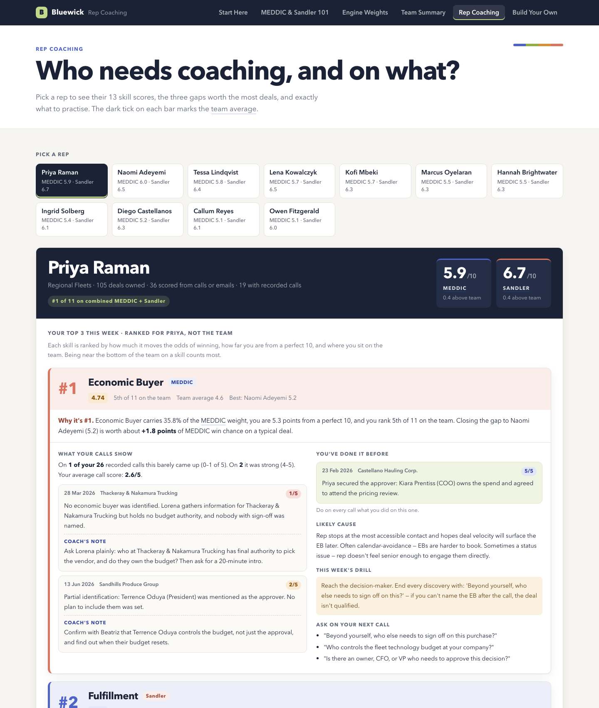
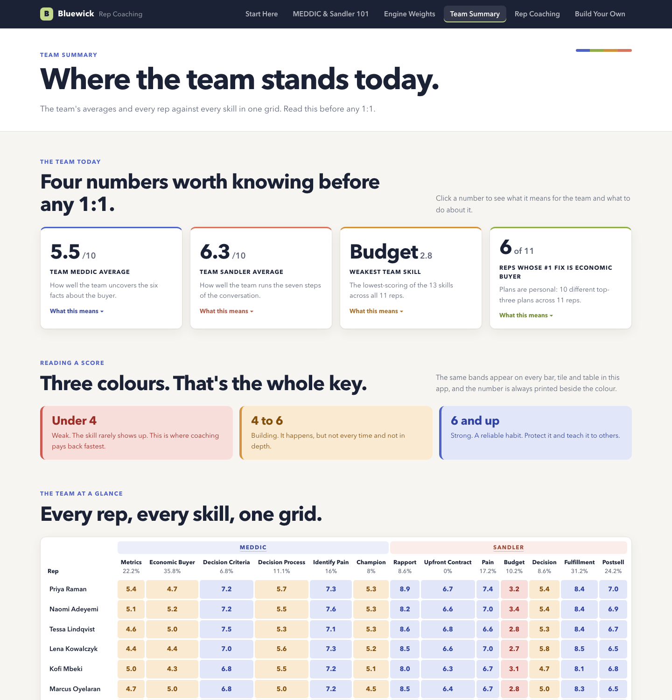
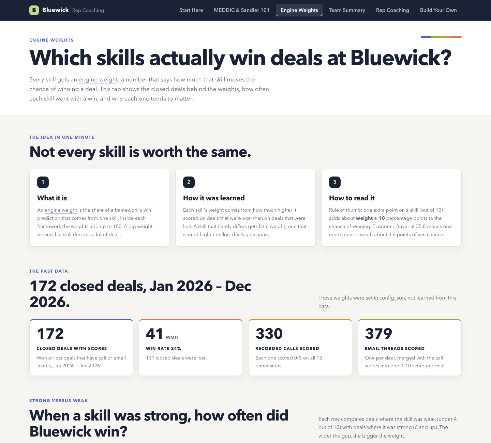

# Rep Coaching skill for Claude Code

Turn your sales team's **recorded calls, CRM deals and email threads** into a coaching app: every call scored on
the 13 skills of two well-known sales methods, MEDDIC and Sandler, and every rep given a **personal top three to
practise**, quoting their own calls.



## What you get

One self-contained HTML file (no server, opens in any browser) with six tabs:

| Tab | What it shows |
|---|---|
| **Start Here** | What the app is and where to go. |
| **MEDDIC & Sandler 101** | What each of the 13 skills means, the question it answers, and what a score of 1, 3 and 5 sounds like. Ends with a quiz. |
| **Engine Weights** | Exploratory associations between observed skill scores and historical wins/losses, with sample counts. |
| **Team Summary** | The team's averages, its weakest skill, and every rep against every skill in one grid. |
| **Rep Coaching** | Per rep: three coached priorities (why it ranks there, two excerpts from their own calls with coaching notes, what good sounds like, a drill, questions to ask), then the other ten skills, each coached. |
| **Build Your Own** | How the system works, using your data as the example. |

| | |
|---|---|
|  |  |

## How it works

1. **Prepare.** A script reads your CRM export, matches each transcript to its deal (by the deal ID in the file
   name) and builds one email thread per deal.
2. **Score.** Claude reads every call and email thread and scores all 13 skills from 0 to 5, each with a quoted
   reason and, on calls, a coaching note. Large batches run in parallel.
3. **Assemble.** A script validates every score, builds a master table (one row per deal plus one row per call),
   combines call and email evidence per deal, averages per rep with each deal counted once, and learns how much each
   skill matters from your won and lost deals.
4. **Build and check.** A script writes the page, and a safety gate checks the table and the finished page before
   you share anything.

The scripts are plain Ruby (standard library only) and **never connect to the internet**. The agent/model you use
does read the CRM export, transcripts and email content to score them; that content is handled under the data,
retention and training settings of that model provider and any enabled subagent workflow. Check those terms and your
company policy before using real customer or employee data. Prefer redacted or synthetic data for the trial run.

## Install

1. Download this repository (green **Code** button, then **Download ZIP**) or clone it.
2. Copy the `rep-coaching` folder into your Claude Code skills folder:
   - macOS / Linux: `~/.claude/skills/rep-coaching/`
   - Windows: `%USERPROFILE%\.claude\skills\rep-coaching\`
3. Start Claude Code. The skill loads automatically when you ask for something it covers.

**Requirements:** Claude Code; Ruby 2.6 or newer (preinstalled on macOS); optionally Google Chrome or Chromium, which
lets the safety gate open the finished page and check every tab.

## Before you start

You will export three things by hand. Claude explains how at each step, so you don't need to prepare in advance, but
it helps to know what is coming:

- [ ] **A CRM export of deals** (CSV): one row per deal with its ID, owner and stage; close date and account name
      help. Include closed deals (won and lost) from the last year or two: that is what the skill learns from.
- [ ] **Call transcripts**: one `.txt` per call, all in one folder.
- [ ] **Email threads** *(optional)*: a CSV of emails with the deal ID, or one `.txt` per deal.

To begin, you only need **one deal, one of its calls, and ideally its emails**. The skill runs a trial on that one
deal first, so you can see it work before exporting everything. The step-by-step export guide Claude shares is in
[`rep-coaching/references/intake.md`](rep-coaching/references/intake.md).

## Use it

In Claude Code, just ask:

> Help me build a rep coaching app from our sales calls.

Claude guides you through it, one step at a time, confirming each before moving on:

1. **CRM export.** Claude explains how to export it, reads the file, suggests which column is which and lists your
   stage names; you confirm the mapping and which stages count as won and lost.
2. **Transcripts.** Claude links each call to its deal. If your file names don't contain deal IDs, it reads each
   transcript, finds the account it mentions, and proposes a deal for you to approve. Nothing is linked without
   your approval.
3. **Emails** (optional), in whichever of two formats is easier for you.
4. **A link report**: how many deals have a call, emails, or both. If nothing links up, it stops and says why.
5. **Wording.** Claude tailors the coaching examples to what your company sells.
6. **A trial on one deal**, scored and built into the app so you can check names, accounts and scores.
7. **The full run**: everything scored, assembled, built and checked, then a plain-English summary.

Before the full run, have a manager or experienced coach review a small sample of the trial scores and quoted
evidence. If their interpretation differs, tune the scoring guidance and repeat the sample before scaling up. This
is a coaching aid, not an objective measure of rep performance.

Already-scored calls are skipped on later runs, so refreshing monthly only scores what is new. Every setting is
described in [`rep-coaching/references/config.md`](rep-coaching/references/config.md).

## Try it without your own data

`examples/bluewick/` is a complete, already-scored run for **Bluewick**, a fictional fleet-telematics company
(1,424 deals, 330 calls, 379 email threads, 11 reps; every name and number is synthetic). Open
`examples/bluewick/bluewick_rep_coaching.html` to see the result, or rebuild it:

```sh
cd rep-coaching
ruby scripts/prepare.rb  ../examples/bluewick
ruby scripts/assemble.rb ../examples/bluewick
ruby scripts/build_app.rb ../examples/bluewick
ruby scripts/check.rb    ../examples/bluewick
```

## How priorities and weights are worked out

- **Combined score per deal:** `(1 − (1 − call/5) × (1 − email/5)) × 10`. When the calls and the emails both show
  a skill, the deal scores higher than either alone.
- **Engine weights:** each skill's weight is based on the difference in average scores between won and lost deals,
  scaled to add up to 100 within each method. This needs at least 40 closed deals with scores (10 won and 10 lost);
  below that, every skill gets an equal weight and the page says so. This is an exploratory association, not evidence
  that a skill caused a deal to win; it does not adjust for segment, deal size, lead source, or other factors.
- **A rep's priorities:** `weight × (10 − score) × (team rank ÷ number of reps)²`. A skill climbs a rep's list when
  it matters, they are far from a perfect 10, and they sit near the bottom of the team on it.

## Privacy

The finished page contains excerpts from real calls and the names of reps and accounts. Treat it as confidential:
store and share it only in approved internal locations, and remove it when no longer needed. The local Ruby scripts
do not make network requests, but this does **not** mean the workflow is fully local: the configured AI model reads
the source data to score it. Review that provider's data-processing and retention settings, your organization's
policy, and any subagent/model settings before using real data. Redact personal or sensitive information where
possible. Never use public hosting for a real-data report.

## Repository layout

```
rep-coaching/            ← the skill: copy this folder into ~/.claude/skills/
  SKILL.md               ← instructions Claude follows
  scripts/               ← prepare, assemble, build_app, check (Ruby, standard library)
  references/            ← scoring rules and config reference
  assets/                ← page template and generic coaching content
examples/bluewick/       ← a complete fictional run, with its finished page
docs/                    ← screenshots
```

## License

MIT. See [LICENSE](LICENSE).
